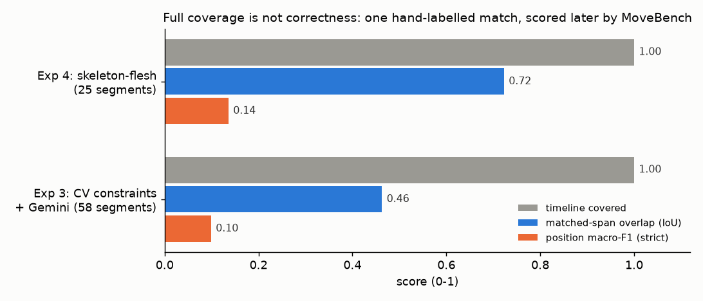

# vlm-experiments — can a frozen VLM read a whole grappling match? (Oct–Dec 2025)

Dhruva's first research thread. Give Gemini one 16-minute no-gi match and ask for a timeline: which position, who is
on top, what happened, plus coaching notes. The answer was checked against Dhruva's hand labels of the same match (32
positions, 62 sub-segments, 122 technique labels, excluding 2 protocol markers (64 and 124 in the raw file); `evaluation/ground_truth.json`). One match is a development case,
not a benchmark.

## What happened
| | approach | what it produced | what it showed |
|---|---|---|---|
| Exp 1 | one Gemini 2.0 Flash pass with a BJJ ontology prompt | score 16.3/100; position accuracy 13.8%; no sub-segments | the model invents positions without constraints |
| Exp 2 | four passes with context caching (85% fewer tokens) | 241 segments for 32 true positions; ~$1 per video | covering the timeline is easy; over-segmentation and wrong classes persist |
| Exp 3 | computer-vision anchors (YOLO pose, scene cuts) + cached Gemini | 58 segments; ~$0.02 | standing probability stops some ground hallucinations; attention fades mid-video |
| Exp 3.3 | two passes to fix the fade ("attention cliff") | 46% coverage | patching after the fact does not work |
| Exp 4 | one integrated "skeleton + flesh" pass, 16 fields per segment | 25 segments, every field filled; $0.013 | the cleanest output, but still unscored at the time |

Sources: [`EXPERIMENTS_PLAN.md`](EXPERIMENTS_PLAN.md) (results per experiment), [`docs/README_2025.md`](docs/README_2025.md)
(the original write-up).

## Scored later (2026)
The [MoveHarness](https://github.com/dhruvinci/moveharness) benchmark re-scored the stored outputs against the same
hand labels, with strict class matching (a lower bound):

| | positions matched | position macro-F1 | matched-span IoU | timeline covered |
|---|---|---|---|---|
| Exp 2 (its own harness) | 22 of 32 | F1 0.677 for finding spans; class accuracy 0.273 | 0.703 | 100% |
| Exp 3 | 5 of 32 | **0.099** (43 of 58 segments say "mount") | 0.463 | 100% |
| Exp 4 | 6 of 32 | **0.136** | **0.723** | 100% |

Source: [MoveHarness `results/baselines.md`](https://github.com/dhruvinci/moveharness/blob/main/results/baselines.md).

**Verdict.** A frozen VLM finds *where* things happen (span overlap ~0.7) but not *what* is happening (macro-F1
≤ 0.14). Coverage, segment counts and filled fields looked like progress and were not.
**Learned.** Score against labels from the start; a complete, fluent timeline can be mostly wrong.
**Next.** It led to [MoveHarness](https://github.com/dhruvinci/moveharness) (an honest scorer), and to grounding the
VLM in measured geometry: [movement-research](https://github.com/dhruvinci/movement-research),
[fast-slow-vision](https://github.com/dhruvinci/fast-slow-vision),
[limb-entanglement](https://github.com/dhruvinci/limb-entanglement),
[kakashi-autolabel](https://github.com/dhruvinci/kakashi-autolabel) and [engage3d](https://github.com/dhruvinci/engage3d).

## Layout
- `experiment/`: the pipelines (Exp 4: `experiment/experiment4/stage0.py`, `stage1_v3.py`); `run_*.py` at the root.
- `prompts/`: prompts and the BJJ ontology. `evaluation/`: scoring server and the hand labels. `hitl/`: a React
  review tool. `outputs/`, `results/`: stored outputs.
- Setup and usage: [`docs/README_2025.md`](docs/README_2025.md#quick-start). The match video is not included.

Code: MIT unless a file says otherwise. Documents and results: CC BY 4.0.
